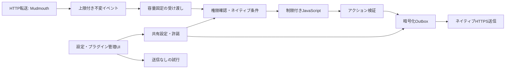

# プラグイン・JavaScript・Webhook 設計仕様

作成日: 2026-10-15
状態: 実装前の提案。今回の依頼は計画書の作成であり、実装・公開・外部送信はまだ行わない。
実装計画: ../plans/2026-10-15-plugin-automation.md

## リリース順序と配布方式（2026-10-16追記）

次の通常更新では、細かなレイアウト・導線の改善とSSL Proxying Listの追加・編集・並べ替え・削除を扱う。スクリプト実行とプラグイン対応は次のメジャーアップデートに分ける。

通常更新では、初回と設定の同意画面を「Data Use & Consent／データ利用と同意」に揃え、説明とレイアウトを共通化する。同意を取り消すボタンは中央に配置し、内容に合う幅と左右の余白を確保する。「How to Use／アプリの使い方」とCapture Setupは一つの入口・画面に統合し、明示的に設定を開始してから同じシート内で設定手順へ進む。[PR #17](https://github.com/qtmleap/Interceptor/pull/17)はdevelopへマージ済み。2026-10-16にTestFlight 1.0.1（34）の内部配布を確認した。出荷ソースは`6c3b8cc2a802ddb5f4555229603821c9ddd9d334`、Mudmouthは`be4cc787669fdfebead90aba197a3501ebdd0063`。新しいNetwork ExtensionのPAC経路は設定・PACテストで確認しており、今回の実機確認は未実施。

2026-10-16の要望により、UIの検証は通常の文字サイズを優先し、XXXL専用対応・追加検証を必須条件から外す。

プラグイン追加の主な導線は、利用者が公開リポジトリを登録し、そこで配布されているスクリプトの一覧から選んで追加する形とする。プラグインはスクリプトと設定・権限情報の配布単位であり、任意のネイティブバイナリを読み込む仕組みにはしない。Files読み込みとアプリ内編集も補助の導線として残す。

リポジトリの読み込みだけでは実行・有効化・Webhook送信・キャプチャ先の追加を行わない。取得元と固定したリビジョン、ソース、要求権限を表示して追加する。更新は差分を確認して利用者が適用し、既存の権限を自動で引き継がない。配布一覧の形式、対応するリポジトリサービス、取得と固定の手順は、次期メジャーの実装前に詳細設計してレビューする。下記の既存レビュー記録は、この追加要件の詳細設計を検証済みとするものではない。

## 1. 目的と完了条件

Interceptorで特定のHTTPリクエスト／レスポンスを検知し、利用者が作成・読み込みしたJavaScriptプラグインで条件判定やJSON整形を行い、利用者が登録した外部Webhookへ自動送信できるようにする。

次の3機能をすべて完成させる。途中のネイティブルールだけの段階で、本件全体を完了と扱わない。

1. 公開リポジトリからのスクリプト選択・追加と、プラグインの作成・編集・Filesからの読み込み・有効化・更新・削除。
2. 実際のJavaScript実行、エラー表示、保存済みキャプチャに対する送信なしの試行。
3. リクエスト単独／レスポンス単独の条件で外部HTTPS Webhookを呼ぶ。アプリ画面が閉じていても、トンネルが稼働している間は処理する。

条件に一致する受信 → JS実行 → Webhook受信を、リクエストとレスポンスそれぞれで実機確認する。サーバーが返答しない場合でもリクエストのイベントは発生する。トンネル停止中の常時実行や送達保証は提供しない。

完了段階を区別する。本依頼の納品は「設計・実装計画の作成」。将来の開発は「3機能の実装完了」「実機検証完了」「公開条件成立」をそれぞれ証跡付きで記録する。Appleの判断が否定・未回答の場合、実装が完成しても公開は未達と明記する。公開できたと装ったり、要求された機能を落として全体完了と扱ったりしない。

## 2. 調査した現在の構成

調査したアプリのGitリビジョンは `18c2ff9ae38ab0cdfe02a88946526702b45f7b49`（TestFlight 1.0.1 / 33）。依存Mudmouthは `be4cc787669fdfebead90aba197a3501ebdd0063`。以下のパス・行はこの調査時点のもの。次期メジャーの実装時は、先行する通常更新が入った最新のdevelopを改めて基準とし、そのSHAを記録する。通常更新で改善したSSL Proxying Listや同意UIを引き継ぎ、古い固定ホスト一覧を再導入しない。

| 現状 | 根拠 | 設計への影響 |
|---|---|---|
| app/extはiOS 17.0。既存テストターゲットの最低OSは18.5 | Interceptor.xcodeproj/project.pbxproj | 製品の最低OSを上げない。既存CIのXcode 27でも検証する |
| UIはSwiftUI、保存はMudmouthのSwiftData | Interceptor/Classes/Tuberose.swift、Mudmouth/Sources/Mudmouth/Models/ModelContainer.swift | 新しいキューは既存Recordのスキーマに混在させない |
| App Groupは `group.jp.qleap.intrcptr` | 両entitlements、ModelContainer.swift | 設定・実行状態をapp/ext間で共有する |
| 9件のProxyOptionと5件のmatchDomainsが別々に固定されている | Tuberose.swift:23、PacketTunnel/PacketTunnelProvider.swift:44 | 明示的なキャプチャ先設定を単一の情報源にする |
| HTTP1の転送はMudmouth、EventLoopは1本 | Mudmouth/Actions/MITM.swift:78、Handlers/ProxyHandler.swift:34 | JS・DNS・DB・送信を転送ループで実行しない |
| Record保存と通知はresponseのendから起動する | ProxyHandler.swift:72 | 保存通知をフックにすると、レスポンス待ちのリクエストを検知できない |
| HTTP.Request/Responseは可変参照型。bodyはgzipを一括展開する | Models/Record.swift:121、170、253 | そのまま別スレッドやJSへ渡さず、上限付きの値型を作る |
| 同意v1を共有UserDefaultsで確認し、extは0.25秒ごとに撤回を監視 | Mudmouth/Sources/Mudmouth/Classes/CaptureAuthorization.swift、PacketTunnelProvider.swift:24 | 外部送信の許諾を別に持ち、送信直前にも失効を確認する |
| アプリ用Keychainはdevice-onlyだが共有access groupを指定していない | Tuberose.swift:45、両entitlements | Webhook専用serviceと既存App Groupを明示し、app/extの共有を実機で確認する |
| RunestoneとJavaScriptのTreeSitter製品はすでにリンク済み | project.pbxproj:17、CodeView.swift | 既存エディタ部品を拡張する |
| CI/CDはMudmouthのSHAを固定している | ios.yml:15、testflight.yaml:84、fastlane/lib/release_config.rb:36、SETUP.md:48 | 2リポジトリを連携し、レビュー済みSHAへ固定を更新する |

## 3. 方式比較と推奨

| 方式 | 利点 | 制約・判断 |
|---|---|---|
| **QuickJSを静的リンクし、トンネル内の専用ワーカーで実行** | 実行中断・ヒープ・スタックの上限を設定でき、画面の生存に依存しない | 第一候補。iOS向けビルド、組み込み処理の中断、実機メモリの試験を先行させる |
| JavaScriptCoreをトンネル内で実行 | OS標準で追加Cコードが少ない | 公開APIだけによる厳格な中断・ヒープ制限を確認できていない。別スレッド放置やSPIを使う方式は採用しない |
| appでJSと送信を実行 | トンネルの負荷を抑えやすい | appの停止中にも動くという要件を満たさない。BGTaskの起床を即時処理の代用にしない |

第一候補を検証し、不成立ならバックグラウンド要件を維持できる再設計を行う。フォアグラウンドだけの仕様へ黙って変更しない。

QuickJSは公式2026-06-04版のソースを候補とする。導入時に配布物のSHA-256、LICENSE、ローカル変更を記録して固定する。未検証のbytecode、quickjs-libcのstd/os、ネイティブモジュールローダーは読み込まない。

## 4. データフローと責務



- Mudmouthは汎用HTTPイベントだけを公開し、プラグインやQuickJSに依存しない。省略可能なsinkをMITM.startTunnelへ渡し、既存の呼び出しを維持する。
- 新規ローカルSwift Package `Packages/InterceptorAutomation` はFoundation / CryptoKit / Network / SQLite3 / CQuickJSで構成する。appとextから利用する。純粋なコアはmacOS 14以降でもテストできるようにする。
- PacketTunnel/AutomationWorkerがMudmouthのイベントをAutomationEventへ変換する。既存Record、SwiftDataモデル、ChannelHandlerContext、ByteBufferの参照は境界を越えない。
- 転送ループのsinkは固定容量へのtry-offerだけを行う。待ち合わせ、ディスク書き込み、Taskの無制限生成は行わない。満杯・ロック競合ではイベントを落とし、理由別カウンターを増やす。
- JSは専用の直列DispatchQueueで動かす。MainActor、NIO EventLoop、Swiftの共有協調実行スレッドを占有しない。1ジョブごとにVMを生成・破棄し、前回のグローバル状態を残さない。
- packageのtarget依存はCore→Foundation、CQuickJS→固定Cソース、Runtime→Core+CQuickJS、Storage→Core+CSQLite+CryptoKit、Transport→Core+Network/Securityとする。公開product InterceptorAutomationが全targetを束ねる。TransportからStorage/Mudmouthへ依存させない。
- CoreにProjectedEvent、AuthorizedWebhookRequest、EndpointCredential、DeliveryOutcome、CancellationTokenを定義する。Runtimeはraw AutomationEventを受け取れない。CancellationTokenはlock保護されたcancel()/isCancelledを持つSendable参照型で、実行終了まで保持するInvocationState経由でC interruptへ渡す。

## 5. HTTPイベントと条件

Phaseは `request.headers / request.completed / response.headers / response.completed` の4種。request.completedはリクエストのend、response.completedは最終レスポンスのendで発生する。ヘッダー時点のイベントはSSEや長時間ストリームでも利用できる。

- リクエストheadでexchangeIDを採番し、同一接続内のFIFOとrequest sequenceでレスポンスを対応付ける。各phaseのeventIDは別UUIDで1回だけ発行する。
- 1xx（100/103等）は最終レスポンスとして扱わない。HEAD、204、304、chunked、pipelining、切断・エラー時の未完了状態を明示的に扱う。
- 101はresponse.headersを1回発行し、その後のWebSocketフレームをHTTPイベントとして扱わない。CONNECT自体は管理通信として除外する。HTTP2/3のネイティブ解析は現行プロキシの対応範囲と別の拡張にする。
- completedのbodyは上限付き。欠落・切り詰め・圧縮未対応・展開超過を状態で示す。truncatedなJSONを完全なJSONとして条件判定しない。
- ネイティブ条件は完全一致host、HTTP method、percent-encoded pathの完全一致／prefix、status範囲、phaseのAND。hostはIDNA正規化し小文字化する。ネイティブの任意正規表現は持たず、必要な式は制限付きJSで評価する。
- 設定するキャプチャ先は完全一致のHTTPSホスト。一覧から生成した同一snapshotをProxyOption、CONNECT許可、matchDomainsに適用する。matchDomains自体はドメインパターンであり、完全一致の認可境界には使わない。CONNECTと内部HTTPのhost/portを照合し、余分なsubdomain、Host重複・欠落・不一致はイベント認可しない。変更は利用者に差分を示し、トンネル再接続で反映する。
- OSのパターン一致でproxyへ来た未承認subdomainは、CONNECT後のTLSを復号しない透過relayへ分岐させ、Record/eventを作らない。接続先authorityを検証し、承認host用のNIOSSLServerHandlerを挿入しない。対象外通信を単に切断することで完全一致を実現したと扱わない。
- プラグインのhost条件は承認済みキャプチャ先の部分集合。読み込みだけでキャプチャ対象を増やさない。既存の対象は移行時に保持し、既存トークン抽出の回帰をテストする。

## 6. プラグイン形式とJavaScript API

プラグイン1件の内容はUTF-8の単一JSON文書（manifestとsource文字列）とする。公開リポジトリの配布一覧からこの形式へ取り込み、スクリプトを選んで追加できるようにする。アプリ内作成、ソースの貼り付け、Filesからの読み込みも用意する。importは実行せず無効状態で保存する。

- manifest: schemaVersion=1、UUIDのid、表示名、semverのversion、subscriptions、read要求、endpointBindings名、JSON形式のsettings。
- PluginRevision: manifestの正規化JSONとsourceのSHA-256。更新は別revisionとして保存し、既存grantを引き継がない。
- hooks: `onRequest(event, config)` / `onResponse(event, config)`。返値は `{ actions: [{ type: "webhook", endpointId, json }] }`。何もしない場合は空配列。
- configは利用者のJSON設定と名前→承認済みEndpointIDの対応。完全なURL・認証キーをJSに渡さない。返値のEndpointIDはnativeが許可リストと照合する。
- 同期関数として実行し、Promise/thenable、循環参照、関数、非有限数、仕様外の返値を拒否する。返値変換・getter・toJSONも実行予算内に含める。
- fetch/XMLHttpRequest、DOM、ObjC/Swiftの任意呼び出し、Keychain、ファイル、モジュールimport、タイマー、動的なネイティブAPIを提供しない。JS自体の条件処理・JSON加工・正規表現等は実行制限の対象。
- 保存Recordに対するdry-runも同じ権限・上限で実行する。送信意図と整形後のJSONを表示し、Outboxへ追加しない。
- ネイティブルールのみのWebhookも同じActionIntentと送信機構を通す。JSプラグインの完成も別途必須。

normativeなv1形式は次の表と例を基準にする。記載のないfieldは拒否する。

| field | 必須・形式 |
|---|---|
| package.manifest / source | 両方必須。manifestはobject、sourceはUTF-8文字列 |
| manifest.schemaVersion/id/name/version | 1 / UUID / 1〜80文字 / semver文字列 |
| subscriptions | 1〜8件の配列。各要素はphaseとmatchが必須 |
| match.hosts/methods | host完全一致の配列（1〜32件）、大文字HTTP method配列（省略時すべて） |
| match.path/status | pathは省略または{kind:exactまたはprefix,value:percent-encoded path}。statusはresponse phaseのみ{min,max}、100〜599でmin≤max |
| read | metadata配列（phase/id/exchangeID/timeは常時付与、追加可能名はmethod/host/status/path）、headers名前配列、queryKeys配列、body object |
| read.body | {mode:none}、{mode:jsonPointers,pointers:[RFC6901文字列]}、{mode:raw}のいずれか。pointer最大32件・各256文字 |
| endpointBindings/settings | binding名配列1〜4件 / JSON object（8 KiB・深さ16以内）。URLや認証を含めず、利用者が別画面でendpointを対応付ける |

| 購読phase | 呼ぶ関数 |
|---|---|
| request.headers / request.completed | onRequest。両方購読した場合はphaseごとに1回呼ぶ |
| response.headers / response.completed | onResponse。同上。購読しないphaseでは呼ばない |

headers phaseを1つでも購読するv1 manifestではread.body.mode=noneを必須とする。body読取が必要なcompleted購読は別pluginにする。headersのallowlistはその方向のheader、queryKeysはどのphaseでも同じexchangeのrequest queryを対象とする。

requestの最小package例:

```json
{
  "manifest": {
    "schemaVersion": 1, "id": "f08c828f-52b6-41bc-b465-fddffae57141",
    "name": "Request alert", "version": "1.0.0",
    "subscriptions": [{"phase": "request.completed", "match": {"hosts": ["api.example.com"], "methods": ["POST"], "path": {"kind": "exact", "value": "/v1/jobs"}}}],
    "read": {"metadata": ["method", "host"], "headers": [], "queryKeys": [], "body": {"mode": "none"}},
    "endpointBindings": ["alert"], "settings": {}
  },
  "source": "function onRequest(event, config) { return { actions: [{ type: 'webhook', endpointId: config.endpoints.alert, json: { eventId: event.id } }] }; }"
}
```

response例は別packageとして次のmanifestを用い、sourceは下のonResponseとする:

```json
{
  "schemaVersion": 1, "id": "05ff53a2-46bb-4bf1-9fd0-908b437f92cc",
  "name": "Response alert", "version": "1.0.0",
  "subscriptions": [{"phase": "response.completed", "match": {"hosts": ["api.example.com"], "status": {"min": 500, "max": 599}}}],
  "read": {"metadata": ["status"], "headers": [], "queryKeys": [], "body": {"mode": "none"}},
  "endpointBindings": ["alert"], "settings": {}
}
```

保存Recordのdry-run変換は専用RecordEventReaderで行う。SwiftData専用ModelActorとpropertiesToFetchによるmetadata-only取得を使い、raw data/body getterを読み出さない。bodyを試す場合は32 KiB以内の明示入力／合成fixtureを別Queueで上限付き解凍・JSON処理する。保存済み巨大bodyを暗黙にロードしないことをgzip bomb／巨大BLOBのテストで測る。画面にmetadataとfixtureのどちらを使ったかを表示する。liveのbodyフックは上限付き実データを使う。

例（response.completed、host=api.example.com、status=500〜599をmanifestで指定）:

```javascript
function onResponse(event, config) {
  return {
    actions: [{
      type: "webhook",
      endpointId: config.endpoints.alert,
      json: { eventId: event.id, status: event.response.status }
    }]
  };
}
```

## 7. 権限・外部送信・撤回

キャプチャ同意と外部送信許諾を分ける。既存の同意v1はv2へ移行するが、Webhookを許可しなくても従来のキャプチャを使えるようにする。再同意前に自動起動しない。

- grantはpluginRevision、capture scope、読み出し項目、EndpointIDとendpointRevision、設定revision、失効epochに結び付ける。初期状態は外部送信OFF。
- 1回のinvocationを1つのendpoint binding/grantに限定する。複数送信先を持つpluginは宛先ごとに異なるprojectionで別実行し、config.endpointsもその1件だけを含める。A用に許諾した本文をBへ送れる権限の合成を防ぐ。
- ProjectedEventのJSON形は共通id/exchangeID/phase/time、request object、response phaseのみresponse object。method/host/pathはrequest内、statusはresponse内に配置する。read.headers/bodyは購読phaseの方向、queryKeysはexchangeのrequestに適用し、未許可fieldはkeyごと省く。
- 既定のJS入力は時刻、phase、method、host、status等の最小メタデータ。path/query/body/headersにも秘密や個人情報があり得るため、用途に応じた明示的な選択を必要とする。
- bodyはJSON Pointerによる項目指定、または上限付きrawの追加許可。headersは名前のallowlist。Authorization/Cookie/Set-Cookie等を暗黙で含めない。projectionはJSへ渡す前に適用する。
- rawを読めるJSはその内容を符号化して返すこともできる。後段の文字列マスクで完全な秘密保護を保証しない。「そのデータを指定先へ送信できる許可」として、プラグインごとの画面で送信先と入力／送信例を示す。
- endpoint編集、スクリプト編集、読取範囲追加、送信先追加では再許諾する。旧revisionの未送信ジョブは新設定に書き換えず取り消す。
- plugin無効化、endpoint削除、capture host削除、キャプチャ同意撤回で該当epochをDB内で更新し、キューを無効化、JSに中断要求、送信中の接続をcancelする。DBの送信許可発行と撤回を同じトランザクション順で管理する。
- 撤回確定後に新しい送信許可を発行しない。既に開始・許可された送信はbest effortでcancelし、既に相手へ届いたデータは取り戻せない。UIとテストもこの境界に合わせる。
- 既存の履歴／トークン削除の仕様を変えず、未送信Outboxは撤回で破棄する。全体の同意撤回では従来どおりVPN停止・自動再接続停止・通知除去も行う。

## 8. 送信先と配送

endpointは利用者がUIで登録・確認する固定HTTPS URL。URL全体（path/queryを含む）と認証値は専用共有Keychainへ保存し、表示用label/host/port/UUIDだけを設定DBに置く。認証はnativeが設定し、キャプチャのCookie等を流用しない。

共有Keychainは既存App Group名 `group.jp.qleap.intrcptr` をkSecAttrAccessGroupに明示し、Webhook専用kSecAttrServiceを使う。Appleの共有仕様上App Group名を利用できるため、新access groupやprofile変更を前提にしない。AfterFirstUnlockThisDeviceOnly、synchronizable=falseを設定し、実署名ビルドのapp/extで権限エラーがないことを確認する。

- HTTPS、正しいポート、URL長上限、userInfo/fragmentなしを検証する。IP literal、localhost、loopback、private、link-local、multicast、未指定・予約アドレスへの接続を拒否する。IPv4-mapped IPv6も正規化する。
- DNS事前確認だけで検査済みとしない。Network.frameworkの接続先を検証したpublic IPに固定し、元のhostでSNIとSecTrustのSSL hostname検証を行うnative送信を第一候補にする。接続ごとに再解決・検査する。既定の信頼検証を弱めない。
- AddressResolverは公開dns_sd.hのDNSServiceGetAddrInfoを専用serial DispatchQueueへ登録して用い、ブロッキングgetaddrinfoは使わない。OSのsystem resolverでA/AAAAを取得し、DNS時間は全体10秒のうち最大3秒、候補最大8件。停止時は同じqueueでrefを解放する。DNS64 prefixは同じresolverのipv4only.arpa AAAA（RFC7050/8880）と既知prefixから確認し、NWPath変更でcacheを捨てる。prefixの安全性を判定できない変換候補は送らず、理由を表示する。G2でDNS経路・NAT64とトンネルへの再流入がないことを実機確認する。
- A/AAAAの検証済み候補を交互に扱い、最大2接続のraceを250 ms差で開始する。失敗時は残り候補へ進み、DNS/TCP/TLS/POST/応答全体で10秒を超えない。接続確立した1本だけがPOSTし、同時に2本へ送らない。IPv6-only/DNS64/NAT64でもpublic IPv4への到達と、埋め込みprivate IPv4の拒否を試験する。
- HTTP/1.1のPOST JSON、Content-LengthとConnection: closeをnative生成する。レスポンスは上限付きの最終status/Retry-Afterのみ取得する。リダイレクトは追わず、Cookie/cache/任意認証challengeやWebhook応答による追加JS実行を設けない。
- 自分のHTTPS送信はプロキシを通さない設計にし、キャプチャ先とendpoint hostが重なる設定を拒否する。DNS alias、実機ルーティングでも自己キャプチャされないことを確認する。秘密の制御ヘッダーを付けるだけでは除外済みとしない。
- deliveryIDは `eventID + pluginRevision + endpointRevision + action index` から安定して導出する。同じIDとpayload bytesで再送し、Idempotency-Keyを付ける。受信側が対応しなければ重複は起き得る。
- 2xxは成功。408/429/5xx、タイムアウトや一時的なネットワーク障害を再試行する。その他4xx、3xx、TLS検証・宛先ポリシー違反は自動再送しない。401/403は認証修正を促す。
- 初回を含め最大5試行。再試行間隔5/30/120/600秒、±20% jitter。Retry-Afterは残りTTL内で尊重する。TTLは15分。
- イベント受け渡しはメモリ内であり、クラッシュ前にOutboxへ確定しなかった分は失われる。確定済みジョブだけを、トンネル再起動時に回復してTTL内で再送する。永久送達・exactly-onceとは表現しない。
- appとextは同じSQLite（既存SwiftDataとは別、WAL、短いtransaction）を使う。extだけが実配送し、lease/owner/sessionで二重workerとクラッシュ後のin-flightを処理する。appのlive testもextへ依頼し、勝手に第2senderを起動しない。
- Outbox payloadはCryptoKit AES-GCM、grantごとのdevice-only Keychain鍵で暗号化。DB/WAL/SHMはApp Group内でbackup除外、first-unlock後のファイル保護。失効時は鍵とジョブを破棄する。起動直後のロック中は復号できるまで送信しない。
- 履歴はID・時刻・status・理由コードを最大1,000件／7日。URL path/query、認証、HTTP body、JSの任意ログ文字列を永続ログへ残さない。
- rate枠は初回・retryとも実送信試行の開始時に1回だけ消費する。新規actionはOutbox容量内なら受け付け、枠がない間はrateLimitedとして待機する。待機中もTTL・件数・bytesへ含める。満杯は新規受付拒否とし、429を含む全試行が枠を消費する。enqueue時とsend時で二重課金しない。
- JS開始前に小さな実行中marker（revision/endpoint/sessionのみ）を永続化する。未完了markerを残して再起動したら該当revisionを「前回中断・要確認」に隔離し、手動再開まで自動実行しない。OS停止かplugin障害かを断定せず、capture本体を復旧させる。
- markerは正常完了／cancelのVM解放後に自分のinvocation IDを照合してclearする。graceful stopはclear完了を待ってackし、失敗を停止成功と偽らない。marker set+clearのp95合計50 ms、invocation全体最大10回/秒をG1/A9で測定する。I/O時間もeventの5秒TTLに含め、50 msのJS時間とは別に計上する。
- invocation枠がないeventは容量固定queue内で待機し、5秒TTLを超えたらexpiredとして破棄・計数する。超過分のTaskを別途作らない。

## 9. 初期リソース予算（OSの保証値ではなく、実測する設計値）

| 対象 | 初期上限／動作 |
|---|---|
| 有効plugin | 16 |
| plugin JSON/import | 256 KiB、source 128 KiB |
| イベント | headers 8 KiB、path 8 KiB、body encoded/decoded各32 KiB、受け渡しqueue 32件 |
| body処理 | EventLoop外、展開比20倍まで、JSON深さ64。超過を明示し、完全body条件を不一致にする |
| JS | 同時1、heap 8 MiB、stack 256 KiB、1回50 ms（source評価〜返値の検証まで） |
| JS中断 | 最低対応実機で150 ms以内の回収を先行試験。組み込みregex等も対象。不成立なら採用不可 |
| JS累積量 | 全体100 ms/秒、burst100 ms。endpoint別invocationも合算し、round-robinで公平化。待機eventは5秒で期限切れ |
| 出力 | 1イベント1pluginあたりaction最大2、JSON合計32 KiB、深さ32 |
| Outbox | 256件、payload合計8 MiB。DB/WAL等のdisk予算16 MiBを監視。超過は新規投入を拒否・計数 |
| 配送 | 同時2、1試行10秒、response headers 8 KiB。pluginごと10件/分・burst2、全体60件/分・burst4を初期設定 |
| 負荷試験 | automation追加RSS 16 MiB以下を目標、転送p95追加遅延5 ms以下。各30分、過負荷でもトンネル停止0回 |

既存Recordのbodyは無制限蓄積・一括gzip展開があり、automationからそのgetterを使わない。追加のmirrorだけを制限しても既存のメモリ問題は消えないため、実機基準測定で既存保存経路が上限試験を妨げる場合は、body保持上限とtruncated表示の小さな互換変更を独立タスクとして先に解消し、トークン抽出を回帰確認する。OSのextensionメモリ上限を固定値で断言しない。

## 10. 管理UI

Settingsに「Automation / 自動化」を追加し、プラグイン、Webhook送信先、送信履歴、キャプチャ対象への導線をまとめる。

1. plugin一覧: 有効状態、hook、対象host、許可先、revision、直近エラー。
2. エディタ: 既存RunestoneのJSハイライト、manifest設定、構文エラーの行、保存時には実行しない。
3. 有効化: コードと権限、送信先host、読み取る範囲、dry-runの送信例を確認して許諾。
4. dry-run: Recordからテスト。network actionは一覧表示のみ。新規の合成fixtureも選べる。
5. endpoint: URL/認証入力、秘密値のマスク、接続テストは明示操作と合成データのみ。トンネル停止時の送信テストは起動を案内する。
6. 履歴: 成功・再試行・期限切れ・許可失効・過負荷dropを区別。キャンセルと再許諾の導線。
7. en/ja、iPhone/iPad、Light/Dark、標準文字サイズ、VoiceOverに対応する。

## 11. 公開前の必須ゲート

技術的に動くこととApp Storeで公開できることを分ける。次は審査規則からの設計上の推論であり、Appleの個別承認を得た事実ではない。

- Appleの2.5.2/4.7は外部コード・プラグイン、4.7.2/4.7.3はAPIとデータ許諾、5.4はVPN由来データの取扱いに条件を置く。利用者の同意だけで外部Webhookが許されるとは判断しない。
- G0で、公開リポジトリから取得する第三者スクリプト、具体的なコード・データ項目・送信先・バックグラウンド挙動を説明した問い合わせ／審査方針と証跡を用意する。必要なAppleの確認・許可が得られない構成を公開しない。Remote feature flagで後から隠れて開放しない。
- 継続的なplugin別grantと4.7.3の「各instance」、4.7.4のindex/universal links、4.7.5の年齢制限の適用も確認対象に含める。問い合わせ回答を実ビルドの審査承認と同一視しない。
- 現行の「外部に自動送信しない」という公開Policy・アプリ内説明・ASC説明を、optionalな送信と整合させる。公開Policy用webリポジトリも別変更としてレビュー・デプロイする。
- consent v2、en/ja説明、PrivacyInfo（実際のデータフローに応じた判断）、ASC App Privacy、Review Notes、第三者ライセンスを一緒にレビューする。過去のbuild30/31等の証跡は歴史資料として保存し、現行の説明だけを更新する。
- 開発用ビルドと出荷可否をビルド時に区別する。フラグOFFの出荷だけで本件の3機能が完成したとは扱わない。

## 12. 参照元とレビュー範囲

一次資料（2026-10-15確認）:
- [Apple App Review Guidelines](https://developer.apple.com/app-store/review/guidelines/) — 2.5.2、4.7、5.1、5.4。
- [JavaScriptCore](https://developer.apple.com/documentation/javascriptcore) — 標準の実行環境。
- [QuickJS公式ドキュメント](https://bellard.org/quickjs/quickjs.html) — interrupt、memory、stack、bytecodeの注意、MIT license。
- [QuickJS公式配布](https://bellard.org/quickjs/) — 2026-06-04版。
- [TLS検証コールバック](https://developer.apple.com/documentation/security/sec_protocol_options_set_verify_block(_:_:_:)) / [SSL hostname policy](https://developer.apple.com/documentation/security/secpolicycreatessl(_:_:))。
- [Keychain項目の共有](https://developer.apple.com/documentation/security/sharing-access-to-keychain-items-among-a-collection-of-apps) — 既存App Group名の利用。
- [RFC7050](https://datatracker.ietf.org/doc/html/rfc7050) / [RFC8880](https://datatracker.ietf.org/doc/html/rfc8880) — DNS64 prefix確認。dns_sd.hの2 APIはCodexがXcode 27の公開iPhoneOS SDK headerでも確認した。

CodexがMac studio上でappと固定版Mudmouthを確認。Claude CodeはLinuxの共有appリポジトリから正確なGitリビジョンを独立調査したが、Mudmouthのcheckoutにはアクセスできなかった。LocalGPTはLocalMCPの接続不通のためファイル未確認で、構成案のみの独立レビューを依頼した。各レビューの結論と反映結果は実装計画の末尾に記録する。
